<h1 align="center">Oi, eu sou a Kalli! 👋</h1>

  <strong>Assistente de QA</strong> · Formada em Análise e Desenvolvimento de Sistemas

  
  

## 👩‍💻 Sobre mim

Sou formada em **Análise e Desenvolvimento de Sistemas** pela **Unisinos** e trabalho como **Assistente de QA**, com foco em testes e qualidade de software.

Nos estudos de desenvolvimento, meu foco é **Python**, **Selenium** e **modelagem de bancos de dados SQL**. Também pratico versionamento com **Git e GitHub**.

## 🛠️ Tecnologias e ferramentas

  

## 🕹️ Atividade no GitHub

  <picture>
    <source media="(prefers-color-scheme: dark)" srcset="https://raw.githubusercontent.com/kallianaa/kallianaa/output/pacman-contribution-graph-dark.svg">
    
  </picture>

  
Ver estatísticas do GitHub

  

    
    
  

